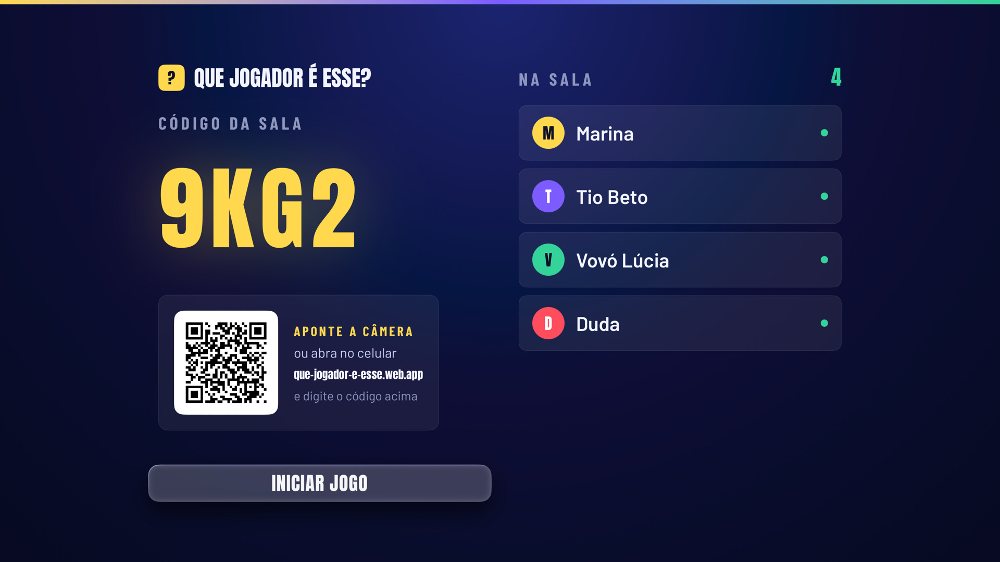
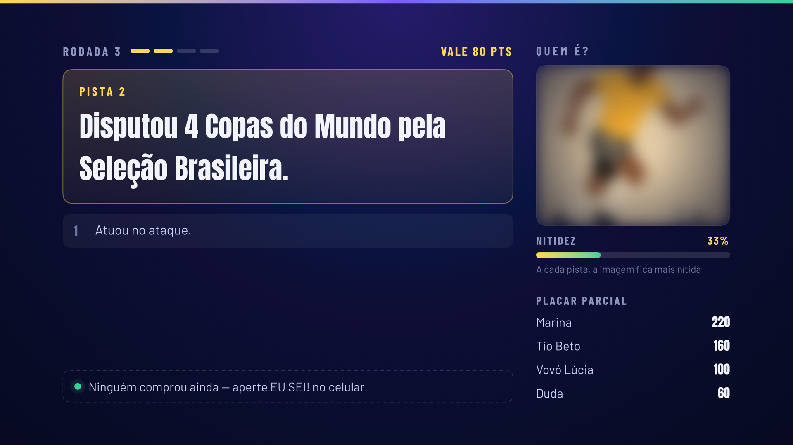
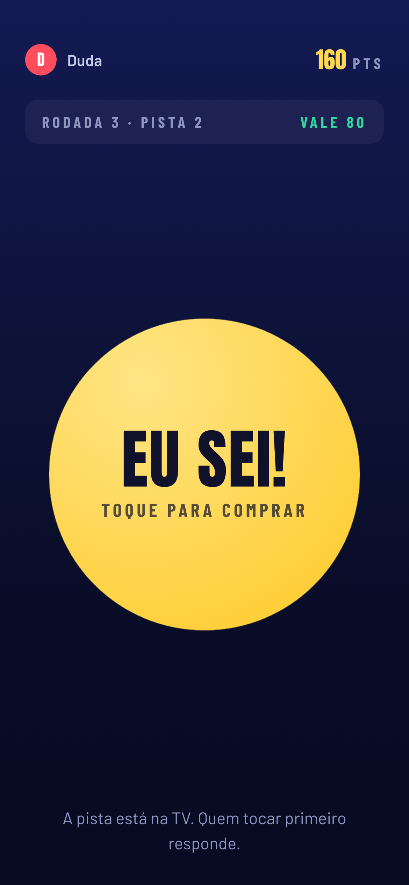
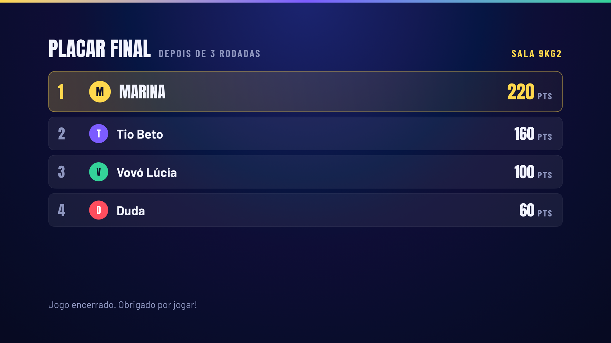

# Que Jogador É Esse?

Jogo de festa para Apple TV: a TV mostra pistas progressivas sobre um jogador de futebol brasileiro, e cada convidado usa o próprio celular como controle, sem instalar nada, sem conta e sem cadastro.

[Baixe na App Store (Apple TV)](https://apps.apple.com/br/app/que-jogador-e-esse/id6808813011)

## Prints

<p align="center">
  
  
</p>
<p align="center">
  
  
</p>

As 14 telas, de TV e de celular, estão em [`docs/telas/`](docs/telas/).

## Principais funcionalidades

- O anfitrião abre o app na Apple TV, que cria uma sala com código de 4 caracteres e QR Code.
- Os convidados entram pelo navegador do celular (PWA), com o código já preenchido pelo QR, e só escolhem um apelido.
- A TV revela uma pista por vez, da mais difícil para a mais fácil, enquanto a ilustração do jogador perde o borrão.
- Quem souber aperta **EU SEI!** e trava o botão de todo mundo; o empate é resolvido por transação no banco.
- Quanto antes se arrisca, mais vale: 100, 80, 60 ou 40 pontos conforme a pista revelada.
- Revelação do jogador e placar da partida na TV.
- Ilustrações estilizadas, sem fotos reais dos atletas.

## Stack técnica

| Camada | Tecnologia |
|---|---|
| App do anfitrião | Swift + SwiftUI, tvOS nativo (`tvos-app/`), projeto gerado por XcodeGen |
| App do convidado | PWA em JavaScript puro, sem framework (`pwa-convidado/`), no Firebase Hosting |
| Estado em tempo real | Firebase Realtime Database (`firebase/database.rules.json`) |
| Ilustrações | Cloud Storage; geradas com a Gemini API (produção de conteúdo, não em tempo de jogo) |
| Autenticação | nenhuma: a segurança vive nas regras do banco |
| Ferramentas | Node.js (pipeline de conteúdo, testes das regras) e Python (scripts de conteúdo e ícones) |

A lógica de negócio vive inteiramente no app tvOS: ele é o único cliente com permissão de avançar o estado do jogo. A PWA só entra na sala e "compra" a resposta.

## Como foi construído

Desenvolvido com Claude (Anthropic) a partir de uma especificação SDD: [`docs/spec.md`](docs/spec.md), com o prompt de design em [`docs/prompt-design.md`](docs/prompt-design.md).

- Convenções, comandos e a principal pegadinha do projeto para o agente de código: [`CLAUDE.md`](CLAUDE.md).
- Testes das regras de segurança do Realtime Database e de concorrência do botão (12 toques simultâneos, 1 vencedor) em [`firebase/tests/`](firebase/tests/), rodando no emulador.
- [`tools/EngineHarness/`](tools/EngineHarness/): roda o motor real do jogo (`RoomEngine`) contra o emulador do banco.
- [`tvos-app/Tests/main.swift`](tvos-app/Tests/main.swift): confere a tabela de pontos e a leitura do modelo.
- Validação do banco de conteúdo por script ([`scripts/validate-seed.mjs`](scripts/validate-seed.mjs)).
- Documentação técnica (árvore de dados, máquina de estados, onde cada regra vive e divergências em relação à spec): [`DOCUMENTACAO-TECNICA.md`](DOCUMENTACAO-TECNICA.md).

## Status

Publicado na App Store para Apple TV.

## Licença

O código está disponível apenas para leitura e estudo. Veja [LICENSE](LICENSE).

## Créditos de terceiros

- Fontes [Anton](https://fonts.google.com/specimen/Anton), [Barlow e Barlow Condensed](https://fonts.google.com/specimen/Barlow), embutidas em `tvos-app/Resources/Fonts/` e `pwa-convidado/fonts/`, distribuídas sob a SIL Open Font License 1.1 por seus autores.
- [Firebase JavaScript SDK](https://github.com/firebase/firebase-js-sdk), © Google LLC, sob a Apache License 2.0, empacotado em `pwa-convidado/vendor/firebase.js` (com os avisos de copyright originais mantidos no arquivo).

Esses componentes continuam sob as licenças originais; a licença deste repositório não se aplica a eles.

## Contribuições

Issues são bem-vindas; pull requests não são aceitos. Veja [CONTRIBUTING.md](CONTRIBUTING.md).

## Como rodar

```bash
npm install
npm run emu                                    # emulador do Firebase
node scripts/baixar-conteudo.mjs --emulador    # carrega o conteúdo no emulador
cd tvos-app && xcodegen generate && open QueJogadorEEsse.xcodeproj
```

### Testes

```bash
npm run test:regras           # regras de segurança do Realtime Database
npm run test:buzz             # 12 toques simultâneos, 1 vencedor só
npm run test:motor            # o RoomEngine real contra o banco
npm run test:swift            # tabela de pontos e leitura do modelo
```

---

Feito pela [Dab Lab](https://www.dablab.com.br/) — agência de inovação no-code para startups e PMEs, com automações usando IA.
